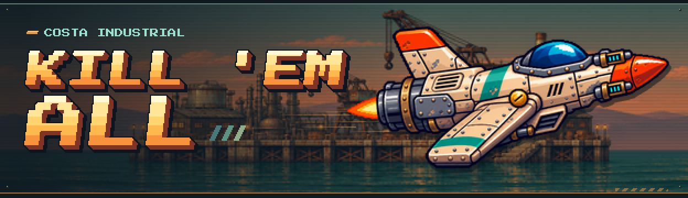
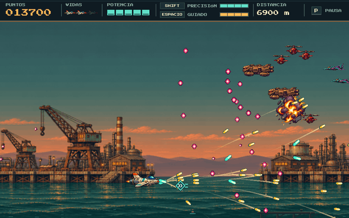

# 

Un *bullet hell* de desplazamiento horizontal hecho en **C++17 y SFML 3.1**. Tenés tres vidas, un avión remachado y una costa industrial que sigue pasando bajo las alas. El cañón dispara solo. Vos elegís entre perseguir una formación para sumar puntos o dejarla pasar para colarte entre sus balas.

[Compilar y jugar en Windows](#compilar-en-visual-studio) · [Controles](#controles)



## Los primeros 45 segundos

El arma mejora por **tiempo de vuelo**. Derribar enemigos suma puntos. La costa sigue de largo mientras te queden vidas.

| Tiempo en vuelo | Qué sale del cañón |
| --- | --- |
| Al despegar | Un disparo dorado hacia adelante. |
| 8 s | Salen tres proyectiles dorados por salva, cada uno con un ángulo que varía de un tiro al siguiente. |
| 18 s | El cañón encadena dos salvas por ráfaga. |
| 30 s | Se suman dos proyectiles verdes que zigzaguean y detonan al tocar un enemigo o tras casi un segundo de vuelo. La explosión también alcanza a los que vuelan cerca. |
| 45 s | Potencia máxima. Cinco proyectiles dorados por salva, ráfagas triples y proyectiles ondulantes. |

De vez en cuando cruza la pantalla un **potenciador turquesa con dos flechas**. Tocá uno con tu avión para multiplicar por **1,5** la cantidad de proyectiles que disparás por segundo. Las mejoras se acumulan hasta el fin de la partida. Con dos potenciadores, la cadencia es **2,25 veces** la habitual para ese nivel de potencia. Cuantos más recogés, más tarda en aparecer el siguiente.

Al despegar, los tiros salen hacia adelante. Algunos dorados se curvan en pleno vuelo y dejan una estela que se afina y se apaga detrás de ellos. Con más proyectiles por segundo, el ángulo de salida varía más, los arcos son más frecuentes y pronunciados y las estelas brillan más. Al llegar al nivel cinco, o antes si juntás suficientes potenciadores, las estelas también desprenden chispas doradas. Los verdes siguen su propio zigzag.

## Controles

| Tecla | Acción |
| --- | --- |
| **WASD** o **flechas** | Moverte en ocho direcciones. |
| **Shift** (mantener) | Activar el vuelo de precisión. Toda la acción pasa al **45 %** de su velocidad y se ilumina el punto vulnerable del avión. |
| **Barra espaciadora** (mantener) | Guiar los disparos dorados y verdes hacia el enemigo más fuerte en pantalla. |
| **P** | Pausar o reanudar. |
| **M** | Silenciar o activar la música y los efectos. |
| **Enter** o **R** | Volver a despegar después de perder las tres vidas. |
| **Esc** | Salir del juego. |

Podés usar **precisión y guiado juntos**. La cámara lenta alcanza el vuelo, el desplazamiento de la costa, los enemigos, las balas de ambos bandos, la cadencia del cañón y las explosiones. También baja el ritmo de la música, los sonidos de combate y las fanfarrias.

Con el **guiado**, los tiros nuevos salen del cañón con su trayectoria habitual y enseguida doblan. Los que ya están en vuelo también buscan el blanco. Todos apuntan al mismo enemigo, con prioridad para el blindado, luego el interceptor y por último el explorador. Si cae el blanco, los proyectiles que siguen en vuelo giran hacia el siguiente. Al soltar la barra, los tiros retoman su trayectoria habitual desde el rumbo que llevaban, incluido el zigzag de los verdes.

Las dos barras de la cabecera arrancan llenas. La de **precisión** da **4 segundos** de uso continuo y tarda **8 segundos** en llenarse desde cero. La de **guiado** da **5 segundos** y tarda **10 segundos** en llenarse. Soltá la tecla y el poder recupera carga. Si lo agotás, la barra marca **RECARGA** hasta llenarse por completo. Si seguís manteniendo la tecla, el poder vuelve a activarse al llenarse. Estos tiempos se miden en segundos reales de juego, incluso en cámara lenta. En pausa las barras se congelan.

## Tráfico sobre el puerto


El **explorador** apunta a tu posición. El **interceptor** dispara en abanicos de tres. El **blindado** llega escoltado y alterna el ángulo de sus abanicos de siete proyectiles. El hueco por el que pasaste la primera vez cambia de lugar en la siguiente descarga.

Cuando cae un blindado, un relámpago ilumina la costa y la cámara se sacude al ritmo de la explosión grave. La **onda expansiva ámbar** barre las balas y los orbes enemigos justo cuando el anillo los alcanza. Cerca del casco, el golpe puede destruir otro blindado intacto. En la periferia hace menos daño y puede rematar una nave averiada. Después de los 30 segundos, algunos convoyes traen dos blindados juntos. Derribá uno para encadenar la segunda explosión y sumar los puntos de ambas bajas.

Con el arma al nivel cinco, uno de cada dos convoyes dobles llega con ocho exploradores adicionales. Vuelan en dos filas junto a los blindados y dejan libre la mitad inferior de su formación. Si esperás a que entren las escoltas antes de derribar el primer blindado, una misma onda y sus explosiones en cadena pueden llevarte hasta el **x10**.

El blindado que inicia la cadena marca la primera nota. Si su onda derriba otra nave, aparece **COMBO x2 +100** debajo del puntaje. El contador crece y pasa de turquesa en x2 a dorado en x4, rosa en x6 y marfil en x10, donde alcanza su tamaño máximo. Cada baja de la cadena suena un poco más aguda que la anterior. Si varias naves explotan juntas, las notas suenan una detrás de otra. [Escuchá las cuatro notas de un combo x4](docs/media/combo-x4.wav).

La tercera baja agrega 200 puntos extra y la cuarta agrega 300. Cuando ves **COMBO x4 +600** en dorado, esos 600 ya están incluidos en tu puntaje, además del valor de cada enemigo. Las bajas por las ondas de los blindados que explotan en cadena también cuentan para ese combo.

Al llegar a **x5** aparece **¡IMPARABLE!** y suena una fanfarria corta. En **x10** aparece **¡LEGENDARIO!** con una fanfarria propia. Si una misma onda cruza ambos hitos de golpe, verás y escucharás los dos en orden. Al perder la última vida, **MEJOR COMBO** muestra la cadena más larga de esa partida.

## Compilar en Visual Studio

Necesitás **Git** y **Visual Studio 2026** con la carga *Desarrollo para el escritorio con C++*. Incluí MSVC para x64, el SDK de Windows y las herramientas de CMake para Windows. El generador de Visual Studio 2026 requiere **CMake 4.2 o posterior**.

Desde **Developer PowerShell for VS 2026**, cloná el proyecto y generá la solución. La primera configuración necesita conexión para descargar SFML 3.1.0 y sus dependencias.

```powershell
git clone https://github.com/ArmandIsCoding/KillEmAll.git
cd KillEmAll
cmake -S . -B build -G "Visual Studio 18 2026" -A x64
Invoke-Item .\build\KillEmAll.slnx
```

En Visual Studio, presioná **F5**. Si preferís jugar directamente desde la terminal, estos comandos compilan y ejecutan la versión Release desde la raíz del proyecto.

```powershell
cmake --build build --config Release --target KillEmAll
.\build\Release\KillEmAll.exe
```

La compilación coloca la carpeta `assets` junto al ejecutable. Si movés el juego, llevá ambos. Para arrancar en silencio desde la raíz del proyecto, usá `.\build\Release\KillEmAll.exe --mute`.

## Dentro del juego

El [sistema de combate](src/Combat.cpp) gestiona las formaciones, las salvas y la energía de los poderes. El [renderizador](src/BattleRenderer.cpp) dibuja el combate con sprites, humo y esquirlas. El [jugador](src/Player.cpp) se encarga de las poses y el movimiento del avión.

El proyecto se distribuye bajo la [licencia MIT](LICENSE). La tipografía **Press Start 2P** incluye su [licencia SIL Open Font License](assets/arcade/font/OFL.txt).
