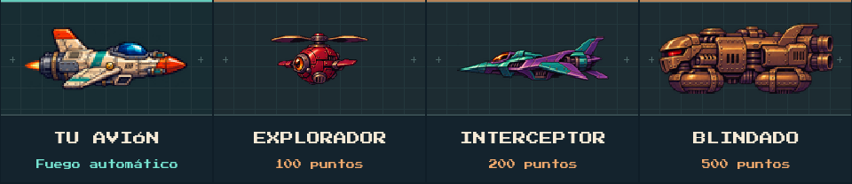
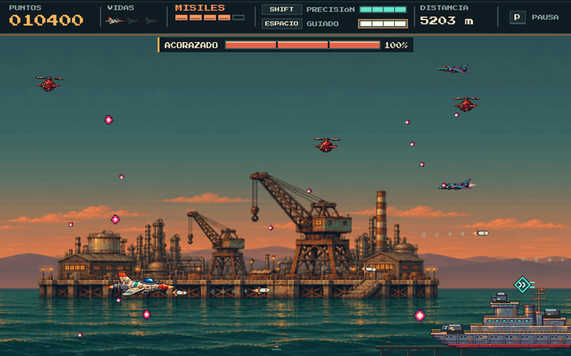
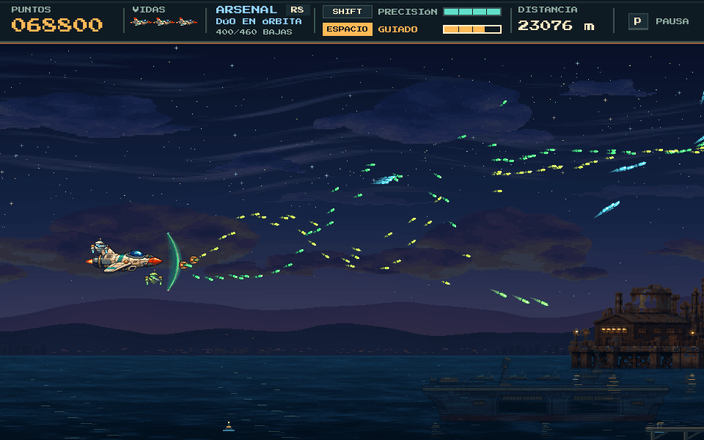

# 

Un *bullet hell* de desplazamiento horizontal hecho en **C++17 y SFML 3.1**. Tenés tres vidas y un avión que dispara solo sobre una costa industrial. Podés alinearte con un convoy para encadenar explosiones, bajar a atacar una lancha o reservar el guiado para el interceptor que te viene siguiendo desde atrás.

[Compilar y jugar en Windows](#compilar-en-visual-studio) · [Controles](#controles)

Cuando perdés una vida, aparece **BAJAS 0/50** debajo de los aviones en **VIDAS**. Al llegar a **45/50**, el contador empieza a parpadear en dorado y se acelera con cada baja. En **49/50** suena una vez un pitido descendente. [Escuchá el aviso de última baja](assets/arcade/audio/life-warning.wav).

Cada 50 enemigos que derribás recuperás una vida, hasta volver a tres. También cuentan las bajas por explosiones en cadena y cada torreta del acorazado que destruís. Si recibís otro impacto mientras seguís en juego, conservás el progreso.

Al recuperar la vida, el avión da un destello dorado al mismo tiempo que aparece **+1 VIDA** debajo del puntaje y suenan tres notas cortas seguidas de un acorde. El brillo se desvanece en menos de medio segundo de vuelo y el cartel sigue visible un poco más. [Escuchá el aviso de vida recuperada](assets/arcade/audio/life-recovered.wav).


## Del cañón al arsenal

El **tiempo de vuelo** y los **potenciadores** que recogés determinan cuándo cambiás de arma. Las **bajas** determinan el rango con el que dispara. En la cabecera, junto al nombre del arma, ves tu rango y cuántas bajas llevás hacia el siguiente. Al cambiar de arma o perder una vida conservás ese rango hasta el final de la partida.

Así es cada arma en rango inicial. Los tiempos son los de una partida sin recoger potenciadores.

| Tiempo en vuelo | Qué sale del cañón |
| --- | --- |
| Al despegar | Un disparo dorado hacia adelante. |
| 8 s | Salen tres proyectiles dorados por salva, cada uno con un ángulo que varía de un tiro al siguiente. |
| 18 s | El cañón encadena dos salvas por ráfaga. |
| 30 s | Se suman dos proyectiles verdes que zigzaguean y detonan al tocar un enemigo o tras casi un segundo de vuelo. La explosión también alcanza a los que vuelan cerca. |
| 45 s | **Misiles**. Salen de a uno, alternando los dos lados del avión. Aceleran en vuelo, dejan humo y explotan al tocar un enemigo. El impacto hace 5 puntos de daño y los rivales cercanos reciben 2. |
| Cerca de 99 s | **Láser**. Cada pulso inflige 8 puntos de daño a los enemigos que atraviesa. El acorazado detiene el haz en el punto de impacto. |
| Cerca de 153 s | **Arsenal**. Se despliega un escudo delante de la nariz. Dos osciladores disparan por turnos desde el otro lado del arco y un robot orbital cubre otros ángulos. |

De vez en cuando cruza la pantalla un **potenciador turquesa con dos flechas**. Mientras usás el cañón, cada uno multiplica su cadencia por **1,5**. Cuando la cadencia base del cañón con esos potenciadores llegaría a 30 proyectiles por segundo, el avión equipa misiles automáticamente. Las mejoras adelantan también el paso al láser, después de al menos 12 segundos con misiles.

Con el láser equipado, el salto al Arsenal tarda entre **22 y 55 segundos de vuelo**, según las mejoras que lleves. El primer robot apunta al enemigo visible más cercano, incluso si viene desde atrás. Los potenciadores que recogés con el Arsenal aceleran la salva frontal y mejoran a los robots.

Los dos osciladores se mueven en sentidos opuestos. Sus dardos verdes y lima se cruzan y se van separando con la distancia. El arco turquesa bloquea las balas y los orbes enemigos que lo tocan y da un destello justo donde pegan. Los tiros que entran por los flancos o por la cola todavía pueden alcanzarte.

Con el Arsenal podés devolver el golpe con una **descarga trenzada**. Atajá un disparo cerca de una punta del escudo. Mientras esa punta siga encendida, mové el avión para atrapar otro tiro con la punta opuesta. Tenés **1,8 segundos de vuelo** y podés empezar por cualquiera de las dos. Los osciladores juntan sus ondas delante de la nariz y lanzan una trenza que inflige **16 puntos de daño** al primer blanco. Con **Shift** tenés más tiempo para acomodar el segundo bloqueo.


Debajo de **ARSENAL** podés ver cuánto falta para el segundo robot. Con el **tercer potenciador** aparece un compañero verde que orbita del lado opuesto al celeste. Cada uno apunta a un enemigo distinto. Si queda un solo blanco, el celeste sigue disparando y el verde espera al próximo. Con las cuatro mejoras, el intervalo base entre descargas de cada robot baja de **0,42 a 0,20 segundos**. El rango por bajas acorta aún más la recarga.


Al despegar, los tiros salen hacia adelante. Algunos dorados se curvan en pleno vuelo y dejan una estela que se afina y se apaga detrás de ellos. Con más proyectiles por segundo, el ángulo de salida varía más, los arcos son más frecuentes y las estelas brillan más. En la última etapa del cañón también desprenden chispas doradas. Los verdes siguen su propio zigzag.

### Diez rangos por bajas

El primer rango llega con **6 bajas**. Los siguientes se alcanzan a las **18, 36, 64, 100, 150, 220, 320, 460 y 660**. También cuentan las bajas de los robots y las explosiones en cadena. Con las tres vidas llenas seguís sumando para el arma.

| Arma | Qué cambia con el rango |
| --- | --- |
| Cañón | Las salvas ganan pares de tiros dorados, más apertura y curvas más pronunciadas. Una vez habilitadas las ondas verdes, pueden salir hasta seis juntas. |
| Misiles | Los lanzadores pasan de alternar un misil a abrir hasta seis en abanico, cada uno con su propia estela de fuego y humo. |
| Láser | Al haz central se le suman pares laterales hasta un máximo de nueve. Con **Espacio** el abanico se cierra sobre el blanco marcado. Cada haz se corta donde toca el acorazado. Si varios alcanzan el mismo blanco, recibe un solo impacto por pulso. |
| Arsenal y robots | Los osciladores pasan de siete a **27 dardos por ciclo**. A mayor rango, sus ondas se abren más y varían la velocidad y la trayectoria de cada tiro. Cada robot puede disparar hasta **cuatro tiros** a distintos puntos del enemigo que está siguiendo. |

En R10 el tiempo entre descargas es un **15 % menor** que en R0 con los mismos potenciadores.

## Controles

| Tecla | Acción |
| --- | --- |
| **WASD** o **flechas** | Moverte en ocho direcciones. |
| **Shift** (mantener) | Activar el vuelo de precisión. Toda la acción pasa al **45 %** de su velocidad y se ilumina el punto vulnerable del avión. |
| **Barra espaciadora** (mantener) | Guiar los disparos del cañón, los misiles y las salvas del arsenal, o apuntar el láser al enemigo más fuerte en pantalla. El robot celeste prioriza ese blanco y el verde apunta al siguiente en prioridad. |
| **P** | Pausar o reanudar. |
| **M** | Silenciar o activar la música y los efectos. |
| **Enter** o **R** | Volver a despegar después de perder las tres vidas. |
| **Esc** | Salir del juego. |

Podés usar **precisión y guiado juntos**. La cámara lenta alcanza el vuelo, el desplazamiento de la costa, los enemigos, las balas de ambos bandos, la cadencia del cañón y las explosiones. También baja el ritmo de la música, los sonidos de combate y las fanfarrias.

Con el **guiado**, los tiros del cañón, los misiles y la salva del arsenal salen con su trayectoria habitual y enseguida doblan. Los que ya están en vuelo también buscan el blanco. El láser apunta directamente a la mira en el instante de cada pulso. Durante el asalto nocturno el guiado prioriza la catapulta y los reflectores, y después el casco del portaaviones. En el resto de la partida sigue el orden **torreta del acorazado, blindado, lancha, interceptor y explorador**. Si derribás al blanco, la mira salta al siguiente. Al soltar la barra, los proyectiles siguen desde el rumbo que llevaban y el próximo pulso vuelve a salir hacia adelante.

La mira es **verde** si al blanco le queda más del 60 % de vida. Pasa a **ámbar** al llegar al 60 % o menos. Cuando le queda un cuarto de vida o menos, o está a un solo punto de caer, la mira **parpadea en rojo**. Al cambiar de blanco, toma de inmediato el color que corresponde a la vida del nuevo enemigo.

Las dos barras de la cabecera arrancan llenas. La de **precisión** da **4 segundos** de uso continuo y tarda **8 segundos** en llenarse desde cero. La de **guiado** da **5 segundos** y tarda **10 segundos** en llenarse. Soltá la tecla y el poder recupera carga. Si lo agotás, la barra marca **RECARGA** hasta llenarse por completo. Si seguís manteniendo la tecla, el poder vuelve a activarse al llenarse. Estos tiempos se miden en segundos reales de juego, incluso en cámara lenta. En pausa las barras se congelan.

Al volver al **100 %**, precisión avisa con **dos campanadas ascendentes** y guiado con **tres pulsos agudos**. Cada aviso suena una vez y la barra correspondiente da un destello en ese mismo instante, incluso si solo gastaste parte de la carga. Si ambas se llenan juntas, brillan las dos. El destello también se ve con el sonido silenciado.

## Tráfico sobre el puerto

Despegás al atardecer. Las boyas y la espuma pasan rápido en primer plano mientras la ciudad, las sierras y dos capas de nubes se mueven más despacio. A los **8 segundos de vuelo** empieza a bajar el sol. Su reflejo dorado se apaga a medida que se oculta detrás de las sierras y aparecen más estrellas entre las nubes. Las balizas de las grúas se prenden primero. Después se iluminan las cabinas y los focos de carga, y sus reflejos se quiebran en las olas bajo el muelle.

Desde los **2 minutos y 20 segundos de vuelo** es noche cerrada. Al otro lado de la bahía se distingue el destello del faro. Podés seguir a las lanchas por sus luces de proa y popa, y reconocer al acorazado por las dos hileras de ventanas iluminadas. Los reflejos acompañan a cada barco y se apagan con él al hundirse. **Shift** ralentiza el anochecer junto con la acción. La pausa congela hasta el titilar de las estrellas y cada partida nueva vuelve a empezar al atardecer.




Al comienzo, el **explorador** apunta a tu posición, el **interceptor** abre un abanico de tres y el **blindado** alterna el ángulo de sus siete orbes. A los **40, 90, 160, 260 y 420 segundos de vuelo** se ensanchan los patrones de ataque. En las últimas oleadas un blindado puede soltar **13 orbes** en una descarga. Las lanchas y las tres baterías del acorazado también ganan proyectiles.

Al despegar recorrés **105 m/s** y llega una formación aérea aproximadamente cada tres segundos. A los cinco minutos recorrés unos **260 m/s**, con una formación por segundo fuera de los encuentros con el jefe. Las escuadras tardías traen refuerzos a otra altura y las lanchas cruzan más seguido. Durante el duelo con el acorazado hay más espacio entre formaciones.

Los aviones entran a distintas velocidades. Algunos exploradores cambian de altura con una curva en S. En las formaciones de pinza, un interceptor con escape fucsia corrige su rumbo hacia vos y lo mantiene durante la pasada final. Una señal en el borde anuncia por dónde entra. En pinzas alternas aparece desde la izquierda.

Las **lanchas patrulleras** navegan por el agua y valen **300 puntos**. Su torreta sigue al avión y brilla al fijar el tiro. Si cambiás de altura en ese momento, el proyectil va hacia la posición anterior. Podés bajar a dispararles de frente, atacarlas con guiado o hundirlas con la onda de un blindado cercano.

### El acorazado

A los **42 segundos de vuelo**, una bocina anuncia al primer jefe. Entra por el agua desde la derecha. La barra **ACORAZADO** muestra sus **120 puntos de integridad** y tres indicadores muestran las torretas de proa a popa. Los proyectiles y el láser dañan el casco y el puente. El buque se ilumina de blanco y se ven pequeñas explosiones en el lugar del impacto.



| Torreta | Cómo reconocer su ataque |
| --- | --- |
| Proa, a la izquierda | El cañón pesado fija tu posición y lanza un orbe grande. Más adelante agrega dos laterales. Cambiá de altura después del destello. |
| Centro, sobre el puente | El antiaéreo arranca con cinco disparos y ensancha su abanico con el tiempo. Podés pasar por los huecos o desactivarlo primero apuntando a la torreta más alta. |
| Popa, a la derecha | La batería rápida hace tres descargas seguidas hacia el punto que fijó antes de la ráfaga. En encuentros avanzados abre tres tiros por descarga. |

Podés apuntar al casco para hundir el barco o a una torreta para desactivar ese ataque. Cada torreta tiene **40 puntos de vida**, vale **250 puntos** y al recibir daño también baja la integridad del barco. Al llegar a cero, el acorazado se hunde, libera una onda expansiva y suma **1500 puntos**. Si sobrevive, a los 34 segundos de encuentro empieza a retirarse hacia la izquierda. Entre acorazados pasan **55 segundos**. El asalto del portaaviones tiene prioridad durante la primera noche.

### El asalto de la primera noche

A los **2:20 de vuelo**, las luces de las grúas se apagan de izquierda a derecha y sus reflejos desaparecen del agua. La música baja hasta que se oye un pulso grave. Dos reflectores barren las nubes y dejan ver la silueta del **portaaviones**. Tenés ocho segundos para tomar posición antes de que abra fuego.



La barra del jefe muestra la integridad del casco y la de sus tres sistemas. Podés elegir a qué altura entrar y qué destruir primero.

| Blanco | Qué cambia al destruirlo |
| --- | --- |
| Catapulta de proa · 60 de vida | Cancela los despegues pendientes y las próximas escuadrillas. Los cazas que ya despegaron siguen peleando. |
| Reflectores de proa y popa · 40 cada uno | Cada foco que apagás reduce los proyectiles de la andanada y hace que los cañones fijen tu posición más temprano. Cuando aparece la cruz de puntería, podés salirte de esa línea. |
| Casco · 300 de vida | Hundís el portaaviones y ganás 2500 puntos. Cada sistema que hayas destruido antes te da otros 350. |

Los osciladores del Arsenal se contestan en estéreo y las bajas en cadena suman percusión a la música del puerto. Cuando el portaaviones se hunde, se escucha un segundo de oleaje antes de que entre la fanfarria y vuelvan las luces del muelle. [Escuchá el oleaje y la fanfarria](assets/arcade/audio/carrier-victory.wav).

### Explosiones en cadena

Cuando cae un blindado, un relámpago ilumina la costa y la cámara se sacude al ritmo de la explosión grave. La **onda expansiva ámbar** barre las balas y los orbes enemigos justo cuando el anillo los alcanza. Cerca del casco, el golpe puede destruir otro blindado intacto. En la periferia hace menos daño y puede rematar una nave averiada. Después de los 30 segundos, algunos convoyes traen dos blindados juntos. Derribá uno para encadenar la segunda explosión y sumar los puntos de ambas bajas.

Con el arma al nivel cinco, uno de cada dos convoyes dobles llega con ocho exploradores adicionales. Vuelan en dos filas junto a los blindados y dejan libre la mitad inferior de su formación. Si esperás a que entren las escoltas antes de derribar el primer blindado, una misma onda y sus explosiones en cadena pueden llevarte hasta el **x10**.

El blindado que inicia la cadena marca la primera nota. Si su onda derriba otra nave, aparece **COMBO x2 +100** debajo del puntaje. El contador crece y pasa de turquesa en x2 a dorado en x4, rosa en x6 y marfil en x10, donde alcanza su tamaño máximo. Cada baja de la cadena suena un poco más aguda que la anterior. Si varias naves explotan juntas, las notas suenan una detrás de otra. [Escuchá las cuatro notas de un combo x4](docs/media/combo-x4.wav).

La tercera baja agrega 200 puntos extra y la cuarta agrega 300. Cuando ves **COMBO x4 +600** en dorado, esos 600 ya están incluidos en tu puntaje, además del valor de cada enemigo. Las bajas por las ondas de los blindados que explotan en cadena también cuentan para ese combo.

Al llegar a **x5** aparece **¡IMPARABLE!** y suena una fanfarria corta. En **x10** aparece **¡LEGENDARIO!** con una fanfarria propia. Si una misma onda cruza ambos hitos de golpe, verás y escucharás los dos en orden. Al perder la última vida, **MEJOR COMBO** muestra la cadena más larga de esa partida.

## Compilar en Visual Studio

Necesitás **Git** y **Visual Studio 2026** con la carga *Desarrollo para el escritorio con C++*. Incluí MSVC para x64, el SDK de Windows y las herramientas de CMake para Windows. El generador de Visual Studio 2026 requiere **CMake 4.2 o posterior**.

Desde **Developer PowerShell for VS 2026**, cloná el proyecto y generá la solución. La primera configuración necesita conexión para descargar SFML 3.1.0 y sus dependencias.

```powershell
git clone https://github.com/ArmandIsCoding/KillEmAll.git
cd KillEmAll
cmake -S . -B build -G "Visual Studio 18 2026" -A x64
Invoke-Item .\build\KillEmAll.slnx
```

En Visual Studio, presioná **F5**. Si preferís jugar directamente desde la terminal, estos comandos compilan y ejecutan la versión Release desde la raíz del proyecto.

```powershell
cmake --build build --config Release --target KillEmAll
.\build\Release\KillEmAll.exe
```

La compilación coloca la carpeta `assets` junto al ejecutable. Si movés el juego, llevá ambos. Para arrancar en silencio desde la raíz del proyecto, usá `.\build\Release\KillEmAll.exe --mute`.

## Dentro del juego

El [sistema de combate](src/Combat.cpp) gestiona las formaciones, las salvas y la energía de los poderes. El [renderizador](src/BattleRenderer.cpp) dibuja el combate con sprites, humo y esquirlas. El [jugador](src/Player.cpp) se encarga de las poses y el movimiento del avión.

El proyecto se distribuye bajo la [licencia MIT](LICENSE). La tipografía **Press Start 2P** incluye su [licencia SIL Open Font License](assets/arcade/font/OFL.txt).
