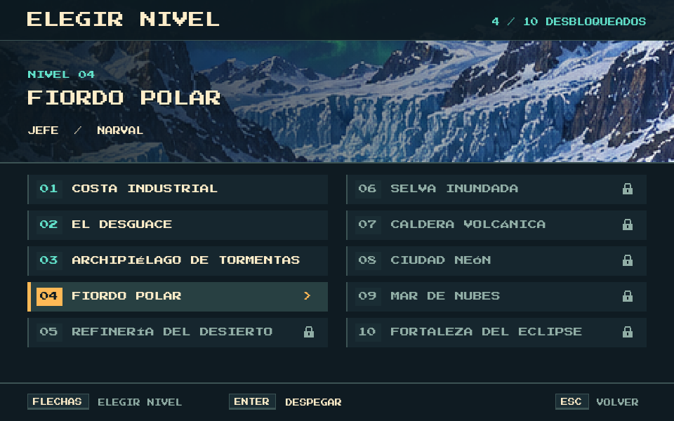
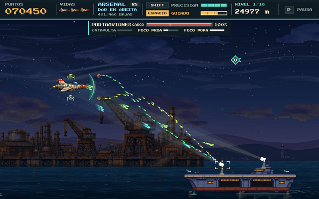
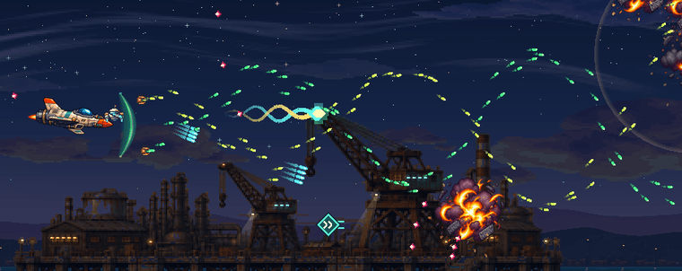
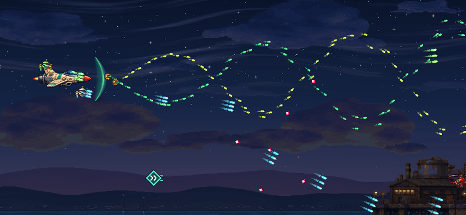
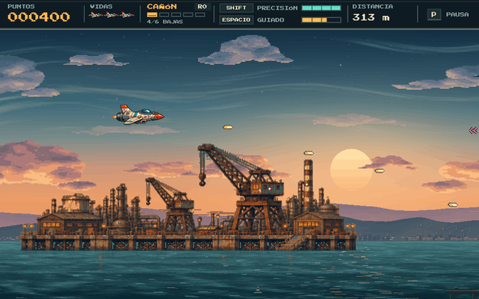
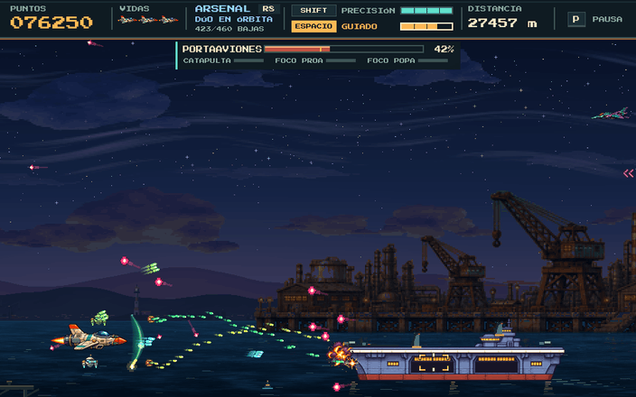

# 

Un *bullet hell* de desplazamiento horizontal hecho en **C++17 y SFML 3.1**. Despegás con tres vidas y un avión que dispara solo. Desde el puerto industrial hasta la Fortaleza del Eclipse te esperan diez escenarios, cada uno con su propio jefe final.

[Compilar y jugar en Windows](#compilar-en-visual-studio) · [Volver a un nivel](#volver-a-un-nivel) · [Controles](#controles) · [Los diez niveles](#los-diez-niveles)

El puerto tiene un tema original de **heavy metal arcade a 150 BPM**. Dos guitarras distorsionadas se reparten el riff en estéreo sobre un bajo con púa y una batería con doble bombo. A mitad de la vuelta, la batería pasa a medio tiempo y entra la melodía de guitarra. [Escuchá el tema del puerto](assets/arcade/audio/coast-patrol.wav).

Cuando perdés una vida, aparece **BAJAS 0/50** debajo de los aviones en **VIDAS**. Al llegar a **45/50**, el contador empieza a parpadear en dorado y se acelera con cada baja. En **49/50** suena una vez un pitido descendente. [Escuchá el aviso de última baja](assets/arcade/audio/life-warning.wav).

Cada 50 enemigos que derribás recuperás una vida, hasta volver a tres. También cuentan las bajas por explosiones en cadena y cada torreta del acorazado que destruís. Si recibís otro impacto mientras seguís en juego, conservás el progreso.

Al recuperar la vida, el avión da un destello dorado al mismo tiempo que aparece **+1 VIDA** debajo del puntaje y suenan tres notas cortas seguidas de un acorde. El brillo se desvanece en menos de medio segundo de vuelo y el cartel sigue visible un poco más. [Escuchá el aviso de vida recuperada](assets/arcade/audio/life-recovered.wav).


## Volver a un nivel

Al superar un jefe se guarda el comienzo del siguiente nivel. La próxima vez que abras el juego, **Continuar** te lleva al nivel más avanzado con las vidas, el puntaje, el arma, los robots y la carga de poderes que tenías al entrar. Podés cerrar el juego incluso durante la explosión del jefe derrotado.

En **Elegir nivel**, movete con las flechas o **WASD** y apretá **Enter** para despegar. Cada escenario recupera su propio punto de partida. Si volvés a superar uno, se actualiza el punto de entrada del siguiente. Tanto al rejugar como al elegir **Nueva partida**, los niveles que ya abriste siguen disponibles.



Durante una partida, **P** y después **L** abren el selector. También podés abrirlo con **L** al terminar. **Esc** vuelve a la pantalla anterior mientras elegís. En Windows, el progreso se guarda por usuario en `%LOCALAPPDATA%\KillEmAll`.

## Los diez niveles

El puerto conserva su dificultad original. El acorazado de los **42 segundos** es un encuentro intermedio. El portaaviones entra a los **2:20 de vuelo** y abre fuego ocho segundos después. Hundilo para pasar al desguace. Desde el nivel 2 tenés **54 segundos de vuelo** antes del jefe, y cada escenario agrega tres segundos más, hasta los **78 segundos** del nivel 10.



| Nivel | Escenario | Jefe final | Qué mirar durante el combate |
| --- | --- | --- | --- |
| 1 | Costa Industrial | Portaaviones | Los reflectores te siguen y la catapulta larga cazas. Al 35 % de casco se incendia la cubierta. |
| 2 | El Desguace | Cizalla | Las pinzas de una grúa flotante disparan por encima y por debajo de tu posición. Destruí una para abrir espacio. |
| 3 | Archipiélago de Tormentas | Albatros | Entra en picada y alterna sus dos baterías. Cuando queda herido dispara con las dos. |
| 4 | Fiordo Polar | Narval | Los tubos del submarino disparan hacia arriba y los proyectiles se curvan hacia tu lado de la pantalla. |
| 5 | Refinería del Desierto | Taladro | Los morteros de un tren blindado elevan las bombas y las dejan caer sobre la posición que fijaron. |
| 6 | Selva Inundada | Anaconda | La cabeza larga espirales. Los dos segmentos que la siguen apuntan desde distintas alturas. |
| 7 | Caldera Volcánica | Basilisco | La máquina camina sobre la caldera y levanta columnas de brasas desde el lomo. |
| 8 | Ciudad Neón | Prisma | Alterna una espiral con un muro de proyectiles. Buscá el hueco señalado antes de que llegue el muro. |
| 9 | Mar de Nubes | Arcángel | Entre las nubes suben patrullas de exploradores. Los hangares de la nave nodriza largan interceptores que te persiguen. Destruí un hangar para cortar sus despegues. |
| 10 | Fortaleza del Eclipse | Corona Negra | Tres baterías orbitan el núcleo entre paredes y espirales. Cuando se enciende el portal magenta de la izquierda, cambiá de altura antes de que los pulsos te alcancen por la cola. |

Al derribar al jefe se despeja la pantalla y el siguiente nivel empieza automáticamente. Conservás tus vidas, las bajas acumuladas hacia la próxima vida, el rango del arma, los robots, la carga de los poderes y el puntaje. Las oleadas suman escoltas, entran por más ángulos y disparan cada vez más rápido. La campaña termina al destruir a Corona Negra. En la pantalla de cierre ves tu puntaje y tu mejor combo.

## Del cañón al arsenal

El **tiempo de vuelo** y los **potenciadores** que recogés determinan cuándo cambiás de arma. Las **bajas** determinan el rango con el que dispara. En la cabecera, junto al nombre del arma, ves tu rango y cuántas bajas llevás hacia el siguiente. Al cambiar de arma o perder una vida conservás ese rango hasta el final de la partida.

Así es cada arma en rango inicial. Los tiempos son los de una partida sin recoger potenciadores.

| Tiempo en vuelo | Qué sale del cañón |
| --- | --- |
| Al despegar | Un disparo dorado hacia adelante. |
| 8 s | Salen tres proyectiles dorados por salva, cada uno con un ángulo que varía de un tiro al siguiente. |
| 18 s | El cañón encadena dos salvas por ráfaga. |
| 30 s | Se suman dos proyectiles verdes que zigzaguean y detonan al tocar un enemigo o tras casi un segundo de vuelo. La explosión también alcanza a los que vuelan cerca. |
| 45 s | **Misiles**. Salen de a uno, alternando los dos lados del avión. Aceleran en vuelo, dejan humo y explotan al tocar un enemigo. El impacto hace 5 puntos de daño y los rivales cercanos reciben 2. |
| Cerca de 99 s | **Láser**. Cada pulso inflige 8 puntos de daño a los enemigos que atraviesa. El acorazado detiene el haz en el punto de impacto. |
| Cerca de 153 s | **Arsenal**. Se despliega un escudo delante de la nariz. Dos osciladores disparan por turnos desde el otro lado del arco y un robot orbital cubre otros ángulos. |

De vez en cuando cruza la pantalla un **potenciador turquesa con dos flechas**. Mientras usás el cañón, cada uno multiplica su cadencia por **1,5**. Cuando la cadencia base del cañón con esos potenciadores llegaría a 30 proyectiles por segundo, el avión equipa misiles automáticamente. Las mejoras adelantan también el paso al láser, después de al menos 12 segundos con misiles.

Con el láser equipado, el salto al Arsenal tarda entre **22 y 55 segundos de vuelo**, según las mejoras que lleves. El primer robot apunta al enemigo visible más cercano, incluso si viene desde atrás. Los potenciadores que recogés con el Arsenal aceleran la salva frontal y mejoran a los robots.

Los dos osciladores se mueven en sentidos opuestos. Sus dardos verdes y lima se cruzan y se van separando con la distancia. El arco turquesa bloquea las balas y los orbes enemigos que lo tocan y da un destello justo donde pegan. Los tiros que entran por los flancos o por la cola todavía pueden alcanzarte.

Con el Arsenal podés devolver el golpe con una **descarga trenzada**. Atajá un disparo cerca de una punta del escudo. Mientras esa punta siga encendida, mové el avión para atrapar otro tiro con la punta opuesta. Tenés **1,8 segundos de vuelo** y podés empezar por cualquiera de las dos. Los osciladores juntan sus ondas delante de la nariz y lanzan una trenza que inflige **16 puntos de daño** al primer blanco. Con **Shift** tenés más tiempo para acomodar el segundo bloqueo.



Debajo de **ARSENAL** podés ver cuánto falta para el segundo robot. Con el **tercer potenciador** aparece un compañero verde que orbita del lado opuesto al celeste. Cada uno apunta a un enemigo distinto. Si queda un solo blanco, el celeste sigue disparando y el verde espera al próximo. Con las cuatro mejoras, el intervalo base entre descargas de cada robot baja de **0,42 a 0,20 segundos**. El rango por bajas acorta aún más la recarga.



Al despegar, los tiros salen hacia adelante. Algunos dorados se curvan en pleno vuelo y dejan una estela que se afina y se apaga detrás de ellos. Con más proyectiles por segundo, el ángulo de salida varía más, los arcos son más frecuentes y las estelas brillan más. En la última etapa del cañón también desprenden chispas doradas. Los verdes siguen su propio zigzag.

### Rangos por bajas sin límite

El primer rango llega con **6 bajas**. Los siguientes se alcanzan a las **18, 36, 64, 100, 150, 220, 320, 460 y 660**. Después de R10, necesitás otras **200 bajas** para R11, **220** para R12 y **240** para R13. Cada nuevo ascenso pide 20 bajas más que el anterior. También cuentan las bajas de los robots y las explosiones en cadena. Con las tres vidas llenas seguís sumando para el arma.

| Arma | Qué cambia con el rango |
| --- | --- |
| Cañón | Gana pares de tiros dorados y ondas verdes. Los dorados salen a distintas velocidades y algunos se arquean. Las ondas verdes también varían de ritmo. |
| Misiles | En R10 salen seis por salva y en R20 salen once. Cada misil acelera y se desvía con su propio ángulo y curvatura. |
| Láser | El haz central marca el rumbo. Los laterales cambian de ángulo en cada pulso. Son nueve haces en R10 y quince en R20. Con **Espacio** se concentran en el blanco. Cada haz se corta al tocar un casco y cada blanco recibe un impacto por pulso. |
| Arsenal y robots | Los osciladores lanzan **27 dardos por ciclo en R10** y **47 en R20**. Aumentan las diferencias de velocidad, apertura y ritmo entre sus ondas. En esos mismos rangos, cada robot pasa de cuatro a seis tiros por descarga, apuntados a distintas partes de su blanco. |

En R10 el tiempo entre descargas es un **15 % menor** que en R0 con los mismos potenciadores. La cantidad de proyectiles y haces que ya hay en pantalla también influye en los disparos nuevos de ambos bandos. Incluso dentro del mismo rango y la misma oleada, las trayectorias se vuelven más irregulares cuando se llena el cielo.

## Controles

| Tecla | Acción |
| --- | --- |
| **WASD** o **flechas** | Moverte en ocho direcciones. |
| **Shift** (mantener) | Activar el vuelo de precisión. Toda la acción pasa al **45 %** de su velocidad y se ilumina el punto vulnerable del avión. |
| **Barra espaciadora** (mantener) | Guiar los disparos del cañón, los misiles y las salvas del arsenal, o apuntar el láser al enemigo más fuerte en pantalla. El robot celeste prioriza ese blanco y el verde apunta al siguiente en prioridad. |
| **P** | Pausar o reanudar. |
| **L** | Abrir el selector de niveles desde la pausa o la pantalla final. |
| **M** | Silenciar o activar la música y los efectos. |
| **Enter** o **R** | Empezar de nuevo en el puerto después de perder las tres vidas o completar la campaña. |
| **Esc** | Volver desde el selector. En el menú principal o durante el vuelo, salir del juego. |

Podés usar **precisión y guiado juntos**. La cámara lenta alcanza el vuelo, el desplazamiento de la costa, los enemigos, las balas de ambos bandos, la cadencia del cañón y las explosiones. También baja el ritmo de la música, los sonidos de combate y las fanfarrias.

Con el **guiado**, los tiros del cañón, los misiles y la salva del arsenal salen con su trayectoria habitual y enseguida doblan. Los que ya están en vuelo también buscan el blanco. El láser apunta directamente a la mira en el instante de cada pulso. Durante el asalto nocturno el guiado prioriza la catapulta y los reflectores, y después el casco del portaaviones. También podés usarlo contra las baterías y los núcleos de los jefes siguientes. Fuera de esos duelos sigue el orden **torreta del acorazado, blindado, lancha, interceptor y explorador**. Si derribás al blanco, la mira salta al siguiente. Al soltar la barra, los proyectiles siguen desde el rumbo que llevaban y el próximo pulso vuelve a salir hacia adelante.

La mira es **verde** si al blanco le queda más del 60 % de vida. Pasa a **ámbar** al llegar al 60 % o menos. Cuando le queda un cuarto de vida o menos, o está a un solo punto de caer, la mira **parpadea en rojo**. Al cambiar de blanco, toma de inmediato el color que corresponde a la vida del nuevo enemigo.

Las dos barras de la cabecera arrancan llenas. La de **precisión** da **4 segundos** de uso continuo y tarda **8 segundos** en llenarse desde cero. La de **guiado** da **5 segundos** y tarda **10 segundos** en llenarse. Soltá la tecla y el poder recupera carga. Si lo agotás, la barra marca **RECARGA** hasta llenarse por completo. Si seguís manteniendo la tecla, el poder vuelve a activarse al llenarse. Estos tiempos se miden en segundos reales de juego, incluso en cámara lenta. En pausa las barras se congelan.

Al volver al **100 %**, precisión avisa con **dos campanadas ascendentes** y guiado con **tres pulsos agudos**. Cada aviso suena una vez y la barra correspondiente da un destello en ese mismo instante, incluso si solo gastaste parte de la carga. Si ambas se llenan juntas, brillan las dos. El destello también se ve con el sonido silenciado.

## Tráfico sobre el puerto

Despegás al atardecer. Las boyas y la espuma pasan rápido en primer plano mientras la ciudad, las sierras y dos capas de nubes se mueven más despacio. A los **8 segundos de vuelo** empieza a bajar el sol. Su reflejo dorado se apaga a medida que se oculta detrás de las sierras y aparecen más estrellas entre las nubes. Las balizas de las grúas se prenden primero. Después se iluminan las cabinas y los focos de carga, y sus reflejos se quiebran en las olas bajo el muelle.

Desde los **2 minutos y 20 segundos de vuelo** es noche cerrada. Al otro lado de la bahía se distingue el destello del faro. Podés seguir a las lanchas por sus luces de proa y popa, y reconocer al acorazado por las dos hileras de ventanas iluminadas. Los reflejos acompañan a cada barco y se apagan con él al hundirse. **Shift** ralentiza el anochecer junto con la acción. La pausa congela hasta el titilar de las estrellas y cada partida nueva vuelve a empezar al atardecer.




Al comienzo, el **explorador** apunta a tu posición, el **interceptor** abre un abanico de tres y el **blindado** alterna el ángulo de sus siete orbes. Todos los cañones enemigos, incluidos los navales, siguen ganando pares de proyectiles con el tiempo de vuelo. En una de sus salvas, un blindado pasa de **7 orbes al despegar** a **19 a los 7 minutos** y **25 a los 15 minutos**.

En cada abanico, el tiro central sigue el rumbo apuntado. Los laterales varían de ángulo y velocidad y pueden curvarse hacia cualquiera de los lados durante los primeros **1,1 segundos**. La estela rosa muestra de dónde vienen. Con **Shift** también se ralentizan estas curvas.

Al despegar recorrés **105 m/s** y llega una formación aérea aproximadamente cada tres segundos. Durante el duelo con el acorazado hay más espacio entre formaciones. En los niveles siguientes el paisaje pasa cada vez más rápido, las escuadras traen refuerzos a otra altura y las lanchas cruzan más seguido.

Los aviones entran a distintas velocidades. Algunos exploradores cambian de altura con una curva en S. En las formaciones de pinza, un interceptor con escape fucsia corrige su rumbo hacia vos y lo mantiene durante la pasada final. Una señal en el borde anuncia por dónde entra. En pinzas alternas aparece desde la izquierda.

Las **lanchas patrulleras** navegan por el agua y valen **300 puntos**. Su torreta sigue al avión y brilla al fijar el tiro. Si cambiás de altura en ese momento, el proyectil va hacia la posición anterior. Podés bajar a dispararles de frente, atacarlas con guiado o hundirlas con la onda de un blindado cercano.

### El acorazado

A los **42 segundos de vuelo**, una bocina anuncia al primer jefe. Entra por el agua desde la derecha. La barra **ACORAZADO** muestra sus **120 puntos de integridad** y tres indicadores muestran las torretas de proa a popa. Los proyectiles y el láser dañan el casco y el puente. El buque se ilumina de blanco y se ven pequeñas explosiones en el lugar del impacto.


| Torreta | Cómo reconocer su ataque |
| --- | --- |
| Proa, a la izquierda | El cañón pesado fija tu posición y lanza un orbe grande. Más adelante agrega dos laterales. Cambiá de altura después del destello. |
| Centro, sobre el puente | El antiaéreo arranca con cinco disparos y ensancha su abanico con el tiempo. Podés pasar por los huecos o desactivarlo primero apuntando a la torreta más alta. |
| Popa, a la derecha | La batería rápida hace tres descargas seguidas hacia el punto que fijó antes de la ráfaga. En encuentros avanzados abre tres tiros por descarga. |

Podés apuntar al casco para hundir el barco o a una torreta para desactivar ese ataque. Cada torreta tiene **40 puntos de vida**, vale **250 puntos** y al recibir daño también baja la integridad del barco. Al llegar a cero, el acorazado se hunde, libera una onda expansiva y suma **1500 puntos**. Si sobrevive, a los 34 segundos de encuentro empieza a retirarse hacia la izquierda.

### El asalto de la primera noche

A los **2:20 de vuelo**, las luces de las grúas se apagan de izquierda a derecha y sus reflejos desaparecen del agua. La música baja hasta que se oye un pulso grave. En el agua se distingue la cubierta del **portaaviones** antes de que sus dos reflectores empiecen a barrer las nubes. Tenés ocho segundos para tomar posición antes de que abra fuego.


La barra **CASCO** marca cuándo se incendiará la cubierta. Debajo ves la vida de la catapulta y de cada reflector. Destruir uno de esos sistemas desactiva su ataque. Para llegar a la fase de incendio, apuntá directamente al casco.

| Blanco | Qué cambia al destruirlo |
| --- | --- |
| Catapulta de proa | Cancela los despegues pendientes y las próximas escuadrillas. Los cazas que ya despegaron siguen peleando. |
| Reflectores de proa y popa | Cada foco que apagás reduce los proyectiles de la andanada y hace que los cañones fijen tu posición más temprano. Cuando aparece la cruz de puntería, podés salirte de esa línea. |
| Casco | Hundís el portaaviones y ganás 2500 puntos. Cada sistema que hayas destruido antes te da otros 350. |

El blindaje del casco y de sus piezas se fija cuando empieza el combate según el arma, el rango y las mejoras de los robots. Por ejemplo, si llegás con **Arsenal R8 y cuatro mejoras**, el casco tiene **3440 puntos de vida**. Las mejoras que ganes durante la pelea te dan ventaja sobre ese blindaje.

Al **35 % de casco** se incendia la cubierta y aparece **FASE II** sobre la barra. Las baterías abren fuego casi al doble de ritmo y agregan tiros laterales. Con ambos reflectores intactos pasa de **4,2 a 2,2 segundos** entre andanadas. Si apagás ambos, en la segunda fase tenés **4 segundos** entre salvas. Esperá la cruz de puntería y cambiá de altura para salir del tiro central.



Los osciladores del Arsenal se contestan en estéreo. Desde **COMBO x2**, los toms y los golpes de plato se suman al compás del riff. Durante el apagón queda un pulso de bajo en mi. Al hundirse el portaaviones, se escucha un segundo de oleaje antes de la fanfarria. [Escuchá el oleaje y la fanfarria](assets/arcade/audio/carrier-victory.wav).

### Explosiones en cadena

Cuando cae un blindado, un relámpago ilumina la costa y la cámara se sacude al ritmo de la explosión grave. La **onda expansiva ámbar** barre las balas y los orbes enemigos justo cuando el anillo los alcanza. Cerca del casco, el golpe puede destruir otro blindado intacto. En la periferia hace menos daño y puede rematar una nave averiada. Después de los 30 segundos, algunos convoyes traen dos blindados juntos. Derribá uno para encadenar la segunda explosión y sumar los puntos de ambas bajas.

Con el arma al nivel cinco, uno de cada dos convoyes dobles llega con ocho exploradores adicionales. Vuelan en dos filas junto a los blindados y dejan libre la mitad inferior de su formación. Si esperás a que entren las escoltas antes de derribar el primer blindado, una misma onda y sus explosiones en cadena pueden llevarte hasta el **x10**.

El blindado que inicia la cadena marca la primera nota. Si su onda derriba otra nave, aparece **COMBO x2 +100** debajo del puntaje. El contador crece y pasa de turquesa en x2 a dorado en x4, rosa en x6 y marfil en x10, donde alcanza su tamaño máximo. Cada baja de la cadena suena un poco más aguda que la anterior. Si varias naves explotan juntas, las notas suenan una detrás de otra. [Escuchá las cuatro notas de un combo x4](docs/media/combo-x4.wav).

La tercera baja agrega 200 puntos extra y la cuarta agrega 300. Cuando ves **COMBO x4 +600** en dorado, esos 600 ya están incluidos en tu puntaje, además del valor de cada enemigo. Las bajas por las ondas de los blindados que explotan en cadena también cuentan para ese combo.

Al llegar a **x5** aparece **¡IMPARABLE!** y suena una fanfarria corta. En **x10** aparece **¡LEGENDARIO!** con una fanfarria propia. Si una misma onda cruza ambos hitos de golpe, verás y escucharás los dos en orden. Al perder la última vida, **MEJOR COMBO** muestra la cadena más larga de esa partida.

## Compilar en Visual Studio

Necesitás **Git** y **Visual Studio 2026** con la carga *Desarrollo para el escritorio con C++*. Incluí MSVC para x64, el SDK de Windows y las herramientas de CMake para Windows. El generador de Visual Studio 2026 requiere **CMake 4.2 o posterior**.

Desde **Developer PowerShell for VS 2026**, cloná el proyecto y generá la solución. La primera configuración necesita conexión para descargar SFML 3.1.0 y sus dependencias.

```powershell
git clone https://github.com/ArmandIsCoding/KillEmAll.git
cd KillEmAll
cmake -S . -B build -G "Visual Studio 18 2026" -A x64
Invoke-Item .\build\KillEmAll.slnx
```

En Visual Studio, presioná **F5**. Si preferís jugar directamente desde la terminal, estos comandos compilan y ejecutan la versión Release desde la raíz del proyecto.

```powershell
cmake --build build --config Release --target KillEmAll
.\build\Release\KillEmAll.exe
```

La compilación coloca la carpeta `assets` junto al ejecutable. Si movés el juego, llevá ambos. Para arrancar en silencio desde la raíz del proyecto, usá `.\build\Release\KillEmAll.exe --mute`.

## Dentro del juego

El [sistema de combate](src/Combat.cpp) gestiona las formaciones, las salvas y la energía de los poderes. El [renderizador](src/BattleRenderer.cpp) dibuja el combate con sprites, humo y esquirlas. El [jugador](src/Player.cpp) se encarga de las poses y el movimiento del avión.

El proyecto se distribuye bajo la [licencia MIT](LICENSE). La tipografía **Press Start 2P** incluye su [licencia SIL Open Font License](assets/arcade/font/OFL.txt).
